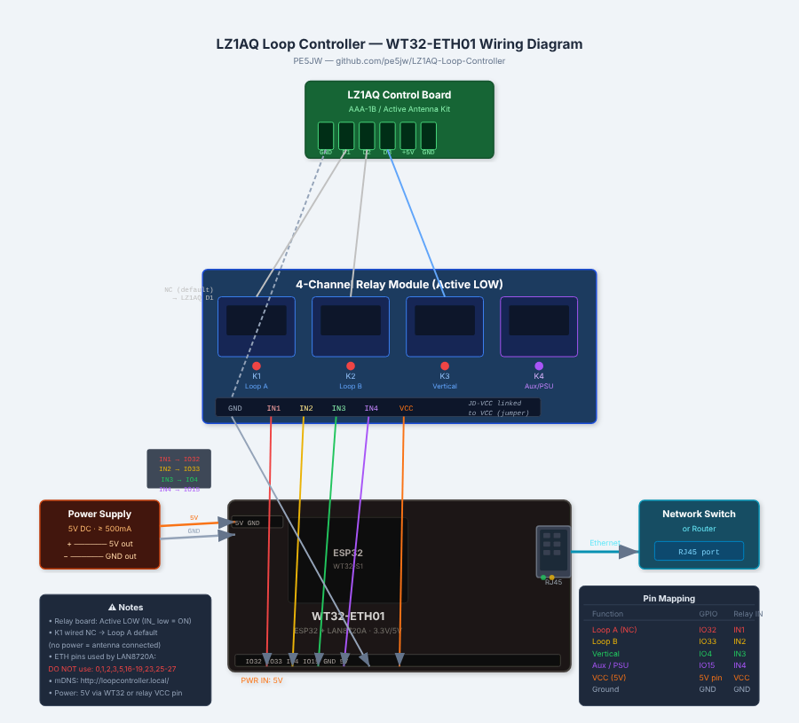

# LZ1AQ Loop Controller 🕹️

Controller for the LZ1AQ Active Antenna Kit — adapted for the **WT32-ETH01 / WT32-ETH02** (ESP32 + wired Ethernet) by [PE5JW](https://github.com/pe5jw).

Original project by [VE2HEW / Anthony DiIorio](https://github.com/anthonydiiorio/LZ1AQ-Loop-Controller).

Instead of WiFi this version uses the **wired Ethernet** port built into the WT32-ETH01/02, making it reliable for outdoor or shack use where WiFi signal may be poor. The web interface and relay logic are identical to the original.


## Wiring diagram



## Hardware

| Part | Description | QTY |
|---|---|---|
| WT32-ETH01 or WT32-ETH02 | ESP32 + LAN8720A Ethernet module | 1 |
| — | 4-channel relay module (Active LOW) | 1 |
| — | 5 V power supply (≥ 500 mA) | 1 |
| — | RJ45 patch cable | 1 |
| — | Hookup / Dupont wire | — |

### GPIO pin mapping (relay board → WT32-ETH01)

| Relay | Function | GPIO |
|---|---|---|
| Relay 1 | Loop A (NC wired) | IO32 |
| Relay 2 | Loop B | IO33 |
| Relay 3 | Vertical | IO4 |
| Relay 4 | Auxiliary (e.g. Power Supply) | IO15 |

> **Note:** The WT32-ETH01 uses several GPIO pins internally for the LAN8720A PHY
> (0, 1, 2, 3, 5, 16, 17, 18, 19, 23, 25, 26, 27). Do **not** use these for the relay board.

## Installation

1. Install the **ESP32 Arduino core** (v2.x or higher):  
   <https://github.com/espressif/arduino-esp32>  
   Add the board URL in Arduino IDE → Preferences, then install `esp32` in the Board Manager.

2. No extra libraries needed — `ETH`, `WebServer` and `ESPmDNS` are all included in the ESP32 core.

3. Select board:  
   **Tools → Board → ESP32 Arduino → WT32-ETH01 Ethernet Module**  
   (If not listed, choose "ESP32 Dev Module".)

4. Connect your board, select the COM port and upload the sketch.

## Configuration

At the top of `LZ1AQ-Loop-Controller.ino` you can change:

```cpp
bool auxEnable = true;            // show 4th relay button in the UI
bool auxNC     = true;            // Normally Closed wiring (inverts button colour)
const char *auxLabel = "Power Supply";  // button label
```

GPIO pins are defined further down — change them if your relay board is wired differently.

## Usage

1. Connect the WT32-ETH01 to your network with an Ethernet cable.
2. Open a browser and navigate to **http://loopcontroller.local/**  
   (or use the IP address printed on the Serial Monitor at 115200 baud).
3. Select the antenna mode — Loop A, Loop B, A+B or Vertical.

The IP address is also shown at the bottom of the web page.

## LZ1AQ switching truth table

| Relay 1 | Relay 2 | Relay 3 | Mode     |
|:-------:|:-------:|:-------:|----------|
| 1       | 0       | 0       | Loop A   |
| 0       | 1       | 0       | Loop B   |
| 1       | 1       | 0       | A + B    |
| 0       | 0       | 1       | Vertical |

> Relay 1 is wired **Normally Closed** so the antenna defaults to Loop A with no power applied.

[LZ1AQ FAQ – digital antenna switching](http://active-antenna.eu/amplifier-kit/faq-aaa-1b/#antenna-swith)
